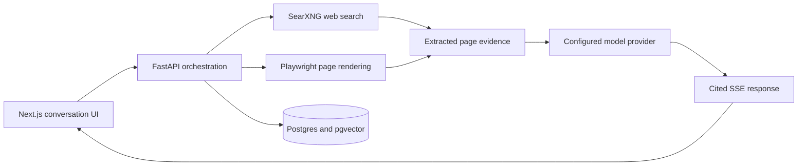

# Lumen

> A self-hosted answer engine with web retrieval, streaming responses, and source citations.

Lumen takes a question, searches the live web, reads the most relevant pages, and streams back a cited answer — with application services running locally and chat/embedding inference using NVIDIA APIs.

```
question → SearXNG → fetch & extract → prompt build → gpt-oss-120b → cited streaming answer
```

---

## Why this project exists

A useful answer engine needs to show where its answer came from. Lumen makes the retrieval path inspectable: search, fetch, extraction, synthesis, and citations are separate parts of the application. It is designed for developers exploring retrieval and agent workflows in a complete web stack.

## Architecture



The UI displays streamed events. The API coordinates retrieval and model calls; Postgres stores the conversation and document state. Browser rendering runs in its own service.

## Highlights

- **Cited streaming answers** — model-generated `[N]` references are rendered as clickable source citations. The UI does not enforce evidence coverage for every claim.
- **Multi-agent modes** — Generalist · Researcher · Coder · Analyst · Orchestrator.
- **Deep research / Computer Use** — the agent takes multiple steps, reads pages, captures screenshots so you can watch it work.
- **PDF Q&A** — drop a PDF in, ask questions about it, jump straight to the cited page.
- **Thread history** — conversations persist in Postgres, sidebar grouped by date.
- **Right-side Assistant panel** — autonomous goal-driven crawler that drives a real browser through a site to find specific things.
- **Query rewriting** — vague questions get decomposed into sharper sub-queries before search.
- **MCP servers** — pluggable tools (time, fetch) via the Model Context Protocol.
- **Self-hosted services** — SearXNG, a browser worker, and storage run through Docker Compose. Model-provider usage depends on your account and current quotas.

## Stack

| Layer | Choice |
|---|---|
| Frontend | Next.js 14 + React 18 |
| Backend | FastAPI + SSE |
| Search | SearXNG (self-hosted, multi-engine) |
| LLM | NVIDIA NIM `gpt-oss-120b` |
| Page render | Playwright (Chromium) microservice |
| Page extract | `httpx` + `trafilatura` |
| DB | Postgres + pgvector |
| Run | Docker Compose |

## Quick start

1. Configure an NVIDIA API key with access to the model used by the backend. Provider pricing and quotas depend on your account.
2. Drop it into `.env`:
   ```
   NVIDIA_API_KEY=nvapi-...
   ```
3. Boot the stack:
   ```
   docker compose up --build
   ```
4. Open [http://localhost:13000](http://localhost:13000).

That's it. Ask a question — you'll see sources stream in, then an answer with citations.

📖 **Want a step-by-step walkthrough of every feature?** See **[GUIDE.md](GUIDE.md)** — practical scenarios for getting answers, deep research, autonomous crawls, PDF Q&A, and more.

## Service map

| Service | Host port | Purpose |
|---|---|---|
| Web (Next.js) | 13000 | UI |
| API (FastAPI) | 18000 | `/ask`, `/assistant/run`, threads, documents, agents, MCP |
| Browser | 18001 | Headless Chromium microservice for JS-heavy pages |
| SearXNG | 18080 | Self-hosted meta-search |
| Postgres | 15432 | Threads, messages, docs, embeddings |

## Try the Assistant panel

Click **Assistant** in the top-right. Give it a URL and a goal in plain English:

> URL: `https://stripe.com`
> Goal: `find pricing for the standard payments plan and any free-trial info`

You'll see screenshots of each page the agent visits, the actions it takes, and a final synthesized answer. Same-domain by default; budgets cap pages, actions, and wall time.

## Repo layout

```
perplexity-from-scratch/
├── api/                  FastAPI service
│   ├── routes/           HTTP endpoints — ask, threads, documents, assistant, agents, mcp
│   ├── agents/           Multi-agent system, prompts, deep-research loop, crawler
│   ├── search.py         SearXNG wrapper + multi_search (parallel sub-queries)
│   ├── query_rewrite.py  Decompose vague questions into search queries
│   ├── browser_client.py HTTP client to the browser microservice
│   ├── rag.py            pgvector storage + retrieval
│   └── mcp_hub.py        MCP server dispatch
├── browser/              Playwright microservice (sessions + actions)
├── web/                  Next.js app
│   ├── components/       Header · Sidebar · Turn · Answer · AssistantPanel · PdfPanel
│   ├── pages/            index, _app, _document
│   └── styles/           globals.css
├── db/init.sql           Schema + pgvector extension
└── docker-compose.yml
```

## License

The original project documentation declares MIT. A standalone license file is not present in the current repository tree.
